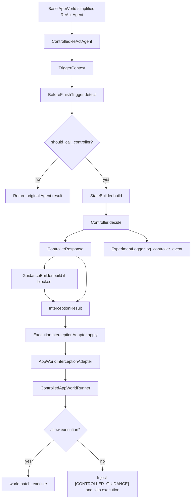
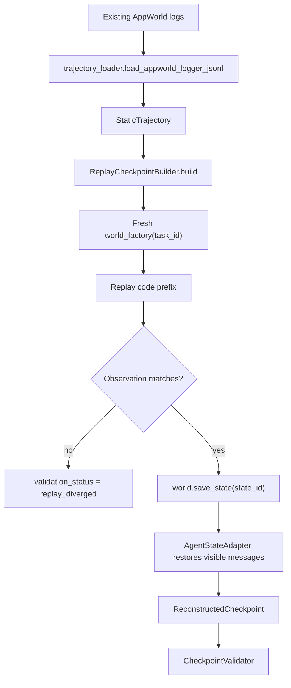
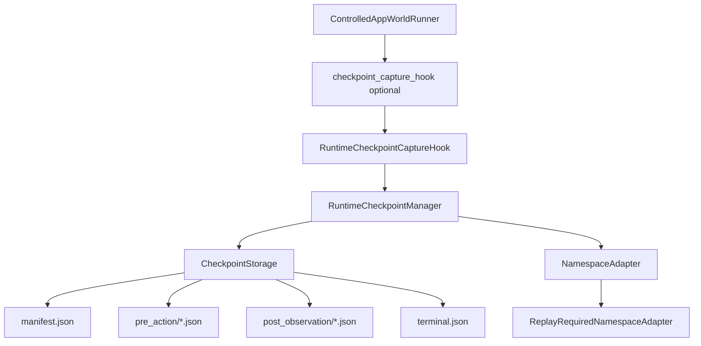
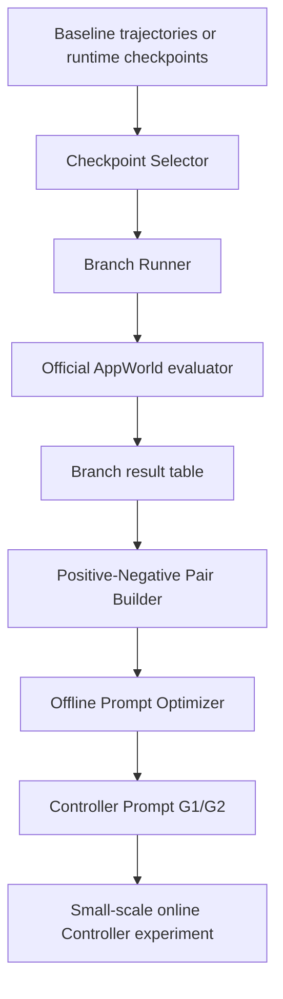

# Module Dependency Map

Repository: `D:\TY\SJTU\CIS\coverage-aware-controller`

This document separates implemented dependencies, interface-only dependencies, and missing dependencies so team members can extend the project without modifying frozen core files.

## Implemented Controller Runtime Graph

Implemented files:

- `controller_agent/integration/controlled_react_agent.py`
- `controller_agent/triggers/before_finish.py`
- `controller_agent/state/builder.py`
- `controller_agent/controller/controller.py`
- `controller_agent/controller/guidance.py`
- `controller_agent/integration/base.py`
- `controller_agent/integration/appworld_adapter.py`
- `controller_agent/logging/logger.py`

Test files:

- `controller_agent/tests/test_controller_agent.py`
- `controller_agent/tests/test_appworld_integration.py`
- `controller_agent/tests/test_end_to_end_smoke.py`
- `controller_agent/tests/test_runner_budgets.py`

## Implemented Checkpoint Prototype Graph

Implemented files:

- `controller_agent/branching/trajectory_loader.py`
- `controller_agent/branching/replay_checkpoint_builder.py`
- `controller_agent/branching/agent_state_adapter.py`
- `controller_agent/branching/checkpoint_validator.py`
- `controller_agent/branching/schemas.py`

Status:

- Mock-tested.
- One intermediate real AppWorld replay validated for task `23cf851_1`.
- No branch continuation yet.

## Runtime Checkpoint Collection Graph

Implemented files:

- `controller_agent/branching/checkpoint_capture_hook.py`
- `controller_agent/branching/runtime_checkpoint_manager.py`
- `controller_agent/branching/checkpoint_storage.py`
- `controller_agent/branching/namespace_adapter.py`

Status:

- Mock-tested.
- Not yet validated in a real baseline AppWorld run.
- Namespace restore currently records `replay_required`.

## Planned Experiment Pipeline

Status by node:

- Baseline trajectories: existing external AppWorld outputs are available locally, not owned by this repo.
- Runtime checkpoints: prototype implemented, mock validated.
- Checkpoint Selector: not implemented.
- Branch Runner: not implemented.
- Evaluator integration for branches: not implemented.
- Positive-Negative Pair Builder: not implemented.
- Offline Prompt Optimizer: not implemented.
- Real LLM Controller Prompt: not implemented.

## Public Interfaces

Frozen core:

- `TriggerDetector.detect(context: TriggerContext) -> TriggerResult`
- `StateBuilder.build(...) -> ControllerInput`
- `Controller.decide(controller_input: ControllerInput) -> ControllerResponse`
- `GuidanceBuilder.build(decision: ControllerDecision) -> str`
- `ControlledReActAgent.inspect_proposed_execution(...) -> InterceptionResult`
- `ExecutionInterceptionAdapter.apply(original_result, interception, agent) -> Any`
- `ControlledAppWorldRunner.run_initialized_world(world) -> None`

Runtime checkpoint interfaces:

- `CheckpointCaptureHook.on_pre_action(**kwargs)`
- `CheckpointCaptureHook.on_post_observation(**kwargs)`
- `CheckpointCaptureHook.on_terminal(**kwargs)`
- `RuntimeCheckpointManager.capture_pre_action(...)`
- `RuntimeCheckpointManager.capture_post_observation(...)`
- `RuntimeCheckpointManager.capture_terminal(...)`

Static replay interfaces:

- `load_appworld_logger_jsonl(task_dir)`
- `ReplayCheckpointBuilder.build(trajectory, checkpoint_step)`
- `CheckpointValidator.validate(checkpoint)`

## Member Ownership Boundaries

Project lead:

- May review all modules.
- Should be the only person approving changes to frozen core.

Controller backend owner:

- Allowed:
  - `controller_agent/controller/`
  - `controller_agent/tests/`
  - `docs/`
- Avoid direct changes to:
  - `controller_agent/integration/controlled_react_agent.py`
  - `controller_agent/integration/appworld_adapter.py`
  - `controller_agent/state/schemas.py`

Trigger and checkpoint selector owner:

- Allowed:
  - `controller_agent/triggers/`
  - future `controller_agent/branching/checkpoint_selector.py`
  - `controller_agent/branching/tests/`
  - `docs/`
- Must not pass evaluator, ground truth, future trajectory, or hidden state into trigger features.

Checkpoint and restore owner:

- Allowed:
  - `controller_agent/branching/`
  - `controller_agent/branching/tests/`
  - `docs/runtime_checkpoint_collection.md`
  - `docs/static_trajectory_checkpoint_notes.md`
- Must not modify core controller contracts without review.

Branch experiment owner:

- Allowed:
  - future `controller_agent/branching/branch_runner.py`
  - future result parsers under `controller_agent/branching/` or `controller_agent/evaluation/`
  - `scripts/`
  - `docs/`
- Must keep branch evaluation offline and use official AppWorld evaluator only.

## Forbidden Direct Modifications Without Review

- `controller_agent/state/schemas.py`
- `controller_agent/integration/controlled_react_agent.py`
- `controller_agent/integration/appworld_adapter.py`
- `controller_agent/integration/base.py`
- `controller_agent/triggers/base.py`
- `pyproject.toml` test discovery settings

## Data And Leakage Boundaries

Controller may receive:

- original task text
- model-visible recent history
- current proposed execution
- prior visible observations
- visible errors
- deterministic counters

Controller must not receive:

- official evaluator result
- ground truth answer
- future trajectory
- hidden AppWorld state
- database snapshots not visible to the Agent
- API keys or provider credentials

Checkpoint and branch modules may store AppWorld state ids for replay and branching, but these must not be fed into the online Controller.
